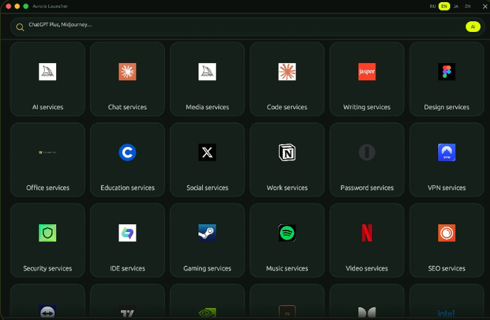

# Kaspersky Total Security Total Free 2026 — anti-spyware, parental, password manager

> **Kaspersky Total Security is paid everywhere. In our Aivora launcher the same paid Total version is free.**
>
> Official site / app store = paid Total subscription. Aivora launcher = that paid Total product, free on Windows 10 / 11.

**Keywords:** Kaspersky Total Security · Kaspersky free · Kaspersky Windows 10 11 · parental controls · paid Kaspersky free through launcher · Aivora Programs

Windows 10 / 11 · Kaspersky Total Security Total · Antivirus

The orange button opens [https://aivoraprograms.com/](https://aivoraprograms.com/). Install Aivora, then **Activate** **Kaspersky Total Security**. You get the **paid Total** product **for free in our launcher**. No `KasperskyTotalSecurity.exe` in this repository.

## What Kaspersky Total Security is

Kaspersky Total Security is the paid 2026 suite: antivirus, **anti-spyware**, **parental controls**, password manager extra, VPN extra on the card. The Aivora listing is **Total Security**, not Kaspersky VPN (that is a VPN-section card) and not the free scanner.

**Kaspersky Total Security is paid everywhere else.** Official access is a Total subscription. In **our Aivora launcher** that same paid Total is **free** on Windows 10 / 11. No vendor account. No credit card.

## anti-spyware, parental, password manager

Parental controls are the family extra. The password manager on this suite is Kaspersky’s, not NordPass. After **Activate**, pick Total Security under Antivirus. The separate Kaspersky VPN tile is another landing.

## Who this Windows page is for

Searches **Kaspersky Total Security**, **Kaspersky Windows**, **Kaspersky free** wanting **paid Total**, not the free scan.

## What the Total card includes

| Feature | Official Kaspersky Total Security | In our Aivora launcher |
|---------|--------------|------------------------|
| Price | Paid Total subscription | **Free** (same paid Total) |
| **Anti-spyware** | Total Security | Same paid Total, free here |
| **Parental controls** | Total Security | Same paid Total, free here |
| **Password manager extra** | Total Security | Same paid Total, free here |

## How to open paid Kaspersky Total Security on Windows

1. Open [https://aivoraprograms.com/](https://aivoraprograms.com/)
2. Download **Aivora Launcher**
3. Install on **Windows 10** or **Windows 11** (64-bit)
4. Open **Antivirus**
5. Find **Kaspersky Total Security** and press **Activate**

Paid Kaspersky Total Security Total — **free in our launcher**, paid on the official site.

## Search queries this page covers

- **Kaspersky Total Security**
- **Kaspersky free**
- **Kaspersky Windows 10**
- **parental controls**
- **paid Kaspersky free through launcher**

## Screenshots

Aivora launcher hub — **Antivirus** → **Kaspersky Total Security**:

## FAQ

**Is this Kaspersky VPN?**  
No. Total Security is antivirus. Kaspersky VPN is a different card.

**Where is the download?**  
[https://aivoraprograms.com/](https://aivoraprograms.com/)

**Is Kaspersky Total Security paid or free?**  
Paid everywhere (official Total). **Free in our Aivora launcher** — same paid Total version.

**Do I need a Kaspersky Total Security account?**  
No. **Activate** on the tile.

---

## На русском

# Kaspersky Total Security Total бесплатно 2026 — anti-spyware, дети, менеджер паролей

> **Везде Kaspersky Total Security платный. В нашем лаунчере Aivora та же платная версия Total — бесплатно.**
>
> Официальный сайт / магазин = платная подписка Total. Лаунчер Aivora = этот же платный Total, бесплатно на Windows 10 / 11.

**Ключевые слова:** Kaspersky Total Security · Kaspersky бесплатно · Kaspersky Windows 10 11 · родительский контроль · платный Kaspersky бесплатно через лаунчер · Aivora Programs

Оранжевая кнопка — главная Aivora. Лаунчер → **Антивирусы** → **Kaspersky Total Security** → **Активировать**. Это **платный Total**, у нас в лаунчере **бесплатно**.

Kaspersky Total Security — платный набор 2026: антивирус, **anti-spyware**, **родительский контроль**, менеджер паролей. Это не карточка Kaspersky VPN и не free-сканер.

**Kaspersky Total Security везде платный.** Официально подписка Total. **В нашем лаунчере Aivora** та же платная Total-версия — **бесплатно** на Windows 10 / 11.

Родительский контроль — семейная опция. Менеджер паролей здесь Kaspersky, не NordPass. VPN Kaspersky — отдельная плитка.

Запросы **Kaspersky Total Security**, **Kaspersky бесплатно** — нужен **платный Total**.

| Функция | Официально | В нашем лаунчере Aivora |
|---------|------------|-------------------------|
| Цена | Платная подписка Total | **Бесплатно** (тот же Total) |
| **Anti-spyware** | Total Security | Та же платная Total, у нас бесплатно |
| **Родительский контроль** | Total Security | Та же платная Total, у нас бесплатно |
| **Менеджер паролей** | Total Security | Та же платная Total, у нас бесплатно |

Как открыть: [https://aivoraprograms.com/](https://aivoraprograms.com/) → лаунчер → **Антивирусы** → **Kaspersky Total Security** → **Активировать**.

**Это Kaspersky VPN?**  
Нет. Total — антивирус. VPN — другая карточка.

Kaspersky Total Security — товарный знак AO Kaspersky Lab. Страница описывает доступ через Aivora Programs.

[https://aivoraprograms.com](https://aivoraprograms.com/) · hello@aivora.app

#windows11 #windows10 #antivirus #kaspersky #aivora

---

*Kaspersky Total Security · Kaspersky free · Kaspersky Windows 10 11 · parental controls · paid Kaspersky free through launcher · Aivora Programs · paid Kaspersky Total Security free through launcher · Aivora Programs · https://aivoraprograms.com/programs/kaspersky-total-security/*
